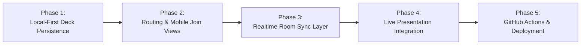

# Realtime Architecture & GitHub Pages Deployment Plan

## 1. Executive Summary

This plan outlines the architecture and step-by-step roadmap for taking **Thoughtmeter (SimpleMeter)** to production on **GitHub Pages**, providing:
1. **Local-First Deck Persistence**: Teachers create and store their slide decks directly in browser `localStorage` (offline-capable, zero DB cost, 100% private).
2. **Serverless Realtime Interactivity ("Semi-Backend")**: Students scan the QR code with their mobile devices to submit live votes, word cloud entries, Q&A questions, and reactions with <50ms latency—without hosting or maintaining a traditional backend server.
3. **Easy Future Migration**: Fully decoupled frontend architecture that can be redeployed to Vercel, Netlify, or custom domains without refactoring.

---

## 2. High-Level Architecture

```mermaid
flowchart TB
    subgraph GitHub Pages Host ["GitHub Pages (Static Web Host)"]
        HTML["index.html + Vite JS Bundle"]
    end

    subgraph Teacher Browser ["Teacher Laptop (Host)"]
        LS[("LocalStorage\n(My Slide Decks)")] <--> Editor["Editor / Dashboard"]
        Editor -- "Start Presentation" --> PresScreen["Fullscreen Presentation Stage"]
        PresScreen -- "1. Init Room (Join Code)" --> RoomEngine["Realtime Room Client"]
    end

    subgraph Cloud Realtime Pipe ["Cloud Realtime Pipe (Firebase RTDB - Free Tier)"]
        RoomState["rooms/{joinCode}\n- currentSlideIndex\n- activeSlideData\n- tallies & submissions\n- reactions"]
    end

    subgraph Audience Mobile ["Audience Smartphone"]
        Scan["Camera Scans QR Code"] --> MobileApp["Mobile Participant View\n(Thoughtmeter/#/join/{joinCode})"]
        MobileApp <--> RoomEngineStudent["Realtime Room Client"]
    end

    HTML -.->|Serves App| Teacher Browser
    HTML -.->|Serves App| Audience Mobile

    RoomEngine <==>|Bi-directional WebSocket| RoomState
    RoomEngineStudent <==>|Submit Votes & Stream Likes| RoomState
```

---

## 3. Technology Stack & Design Decisions

### A. Static Hosting: GitHub Pages
- **Repo URL**: `https://github.com/FirstPotatoCoder/Thoughtmeter`
- **Site URL**: `https://firstpotatocoder.github.io/Thoughtmeter/`
- **Routing**: Client-side hash routing (`/#/` for editor/presenter, `/#/join/:roomCode` for participants) to avoid 404s on static hosting.
- **Vite Config**: Set `base: '/Thoughtmeter/'` for production builds while maintaining `/` for local development.

### B. Storage: Local-First `localStorage`
- **Decks Key**: `thoughtmeter_decks`
  ```ts
  interface Deck {
    id: string;
    title: string;
    updatedAt: number;
    slides: Slide[];
  }
  ```
- **Active Deck Key**: `thoughtmeter_active_deck_id`
- **Import / Export**: Built-in JSON export/import so teachers can share quiz templates with colleagues.

### C. Realtime "Semi-Backend": Firebase Realtime Database
> [!NOTE]
> **Why Firebase RTDB instead of WebRTC/PeerJS?**
> School and university Wi-Fi networks typically run strict symmetric NATs and enterprise firewalls that frequently block WebRTC peer-to-peer data channels. Firebase RTDB uses standard secure WebSockets (WSS on port 443) which works 100% reliably across cellular, school Wi-Fi, and guest networks.

- **Zero backend code**: Run entirely via the client-side Firebase JS SDK (`firebase/database`).
- **Free Tier limits**: 100 simultaneous active connections and 1 GB data storage (more than sufficient for hundreds of classes).
- **Auto-Cleanup / Ephemeral Sessions**: Rooms are keyed by short 6-digit numeric codes (e.g. `759535`).

---

## 4. Implementation Phases



### Phase 1: Local-First Deck Storage Engine
- [ ] Create `src/utils/deckStorage.js` with helper methods:
  - `loadDecks()`: loads all decks from `localStorage` with fallback to starter slides.
  - `saveDeck(deck)`: saves current slide deck to `localStorage`.
  - `createDeck(title)`: creates a new empty or template deck.
  - `exportDeck(deckId)` / `importDeck(jsonString)`: file export/import utilities.
- [ ] Connect `App.jsx` state to `deckStorage` so slide changes auto-persist across reloads.
- [ ] Add deck title editing and basic deck switcher in the top bar.

### Phase 2: Client-Side Routing & Dedicated Mobile Join Screen
- [ ] Set up lightweight hash-based router:
  - `/#/` → Main editor / presenter interface.
  - `/#/join/:code` → Standalone fullscreen mobile participant view (optimized for mobile browsers, hiding top bar and presenter controls).
- [ ] Ensure the mobile participant view reuses our existing phone screen components from `PresentationPreview.jsx`.

### Phase 3: Realtime Room Sync Service (`RoomService.js`)
- [ ] Abstract real-time interactions into a clean client service (`src/services/roomService.js`):
  - `hostCreateRoom(deck, joinCode)`: initializes room in cloud, listens for student submissions.
  - `hostChangeSlide(joinCode, slideIndex)`: notifies all audience phones when presenter changes slide.
  - `participantJoinRoom(joinCode)`: listens for active slide updates from presenter.
  - `participantSubmitResponse(joinCode, slideId, payload)`: pushes vote / word / question.
  - `participantSendReaction(joinCode, type)`: broadcasts floating reaction to host.
- [ ] Configure free Firebase project or lightweight signaling instance.

### Phase 4: Full Presentation Integration
- [ ] Update `PresentationPreview.jsx`:
  - When "Start presentation" is clicked, generate a live `joinCode` and activate `RoomService`.
  - Display actual dynamic QR code pointing to `https://firstpotatocoder.github.io/Thoughtmeter/#/join/{joinCode}`.
  - Bind live submissions (MCQ bar updates, Word Cloud additions, Q&A question arrivals) to the presenter state.
  - Bind live reaction broadcasts to trigger floating thumbs-up reactions.
- [ ] Add live audience count indicator ("X participants connected").

### Phase 5: GitHub Pages CI/CD Workflow
- [ ] Create `.github/workflows/deploy.yml` to automatically build Vite app and deploy `dist/` to GitHub Pages upon pushing to `main`.
- [ ] Configure `vite.config.js` with dynamic `base` property for GitHub repo subpath.
- [ ] Test on real smartphones (scanning physical QR code).

---

## 5. Verification & Testing Strategy

1. **Local Multi-Device Simulation**:
   - Run Vite on local network (`npm run dev -- --host`).
   - Open presenter view on laptop, open participant view on real smartphone on the same Wi-Fi.
   - Verify:
     - MCQ votes update live on presenter screen in <100ms.
     - Word cloud recalculates word frequencies live.
     - Q&A questions appear in queue and can be upvoted.
     - Thumbs-up tapping streams floating reaction bubbles across the laptop screen.
2. **Persistence Stress Test**:
   - Refresh editor tab: verify all slides, options, and question titles reload intact.
   - End presentation: verify student votes can be cleared or preserved.
3. **GitHub Pages Deployment Test**:
   - Push to GitHub, ensure workflow passes, and verify assets load with correct base path.
